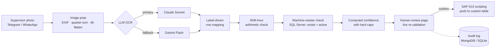

# Shop-floor OCR → SAP

**Turns a photo of a handwritten production sheet into validated SAP entries. No typing, and no bad data gets through to the ERP.**

Built for a multi-plant textile manufacturer. It runs in production in the carding department and is being rolled out to the group's other plants.


---

## The problem

Carding supervisors record machine routing every shift in paper registers. Each sheet has a date, a shift, a supervisor and up to six material rows. Every row has 26 machine slots across five sections, and the cells hold entries like `15(1/2)`, `o2, n3` or `28`. Someone used to type all of this into SAP table maintenance by hand, which was slow and error-prone.

The hard part isn't reading handwriting. It's making sure a misread can never reach SAP looking valid: one wrong digit turns machine 15 into machine 16, which is also a real, active machine.

## How it works



## Engineering decisions

The accuracy fixes, each tied to the failure it removed:

| Failure seen in production | Root cause (measured) | Fix |
|---|---|---|
| Finisher-card values landed one row too high, but only on the right side of the sheet | A −2.6° camera tilt caused 31 px of vertical drift on a 37 px row at 676 px from the label column | `image_prep.py` fits the ruled-line angle and applies an affine flatten. Drift on the same sheet dropped to **6 px**. |
| A whole row of machines got filed under the wrong material, silently, with valid SAP codes | The LLM was asked to fill six fixed JSON keys and had to guess which row was which | `material_rows.py` has the model return rows **with their handwritten labels**, then maps them deterministically in Python. Unknown labels raise a warning instead of being guessed. |
| A misread digit produced another valid, active machine, so the DB check passed | A machine-master lookup can't tell which row a number was written on | `shift_check.py` checks the arithmetic: a machine can't run more than one shift's hours per shift (`2(1/2) + 2(1/2) = 8 h` is fine, `7 + 7` is not). A row shift trips 10–15 warnings at once. |
| The confidence meter read 95% on wrong sheets and never moved after a correction | The model reported its own confidence | `confidence.py` computes every score from checkable facts. Hard caps: any machine not in the master caps the score at 75. The score goes up as the operator fixes cells. |

Other details:

- **The LLM has a fallback.** Claude is tried first, then Gemini. The cost and latency of each call are logged per sheet in INR.
- **Multi-mill, multi-shed encoding.** Supervisors prefix machine numbers with `o`/`n` for the old and new shed (`o2` → `031BC002`, `n2` → `032BC002`). These letters are only valid at the mill that has two sheds. On the other mills a letter blocks confirmation instead of guessing. Python and the JavaScript frontend use the same parser, so they always produce the same codes.
- **A human stays in the loop.** The review page re-validates as the operator edits: the header after 500 ms of no typing, machine cells after 1200 ms. Nothing goes to SAP until a person confirms.
- **SAP write path.** It uses SAP GUI scripting (`win32com`) against a custom table-maintenance transaction. Two machine classes are merged into one key to avoid duplicate-key failures on save.
- **Audit trail.** Every OCR call, edit, confirm and push is logged with user, host, confidence and cost. MongoDB is the primary store with SQLite as an automatic fallback, and the audit log can never crash the app.
- **Channel-agnostic intake.** The server exposes one API (`/api/ocr` → `/api/carding_preview/create`). The Telegram bot in `intake/telegram` and an existing WhatsApp bot both call the same API. The Telegram bot adds a user whitelist, per-user mill selection, and download retries.

## Repo layout

```
app/
  app.py              Flask API + review flow + SAP push orchestration
  image_prep.py       geometric correction (tilt, rotation, contrast)
  material_rows.py    OCR prompt + label → material mapping
  shift_check.py      shift-hour arithmetic validation
  confidence.py       computed confidence scoring
  audit_log.py        audit trail (MongoDB / SQLite)
  sap_script.py       SAP GUI scripting push
  carding_preview.html, templates/index.html
intake/telegram/      Telegram intake bot (python-telegram-bot)
sap/                  helper to discover SAP GUI field IDs
tests/                unit tests for the validation layer
```

## Run locally

```bash
python -m venv venv && venv\Scripts\activate
pip install -r requirements.txt
copy .env.example .env          # fill in keys and DB settings
copy config\supervisors.example.txt config\supervisors.txt
python app/app.py               # http://localhost:5001
pytest -q tests
```

The SAP push needs SAP GUI with scripting enabled on Windows. Everything else, including OCR, validation and review, runs without SAP.

## Limitations

- SAP GUI scripting is brittle compared with an RFC/BAPI or OData integration. It was chosen because no API was exposed for the custom table. Moving to RFC is the next step.
- The server runs on a LAN machine, so the review link only works on the mill network.
- OCR quality depends on the photo. Very blurred or heavily cropped sheets still need manual correction, which the confidence caps are designed to surface.

---

Credentials, hostnames, employee names and production data have been removed.
